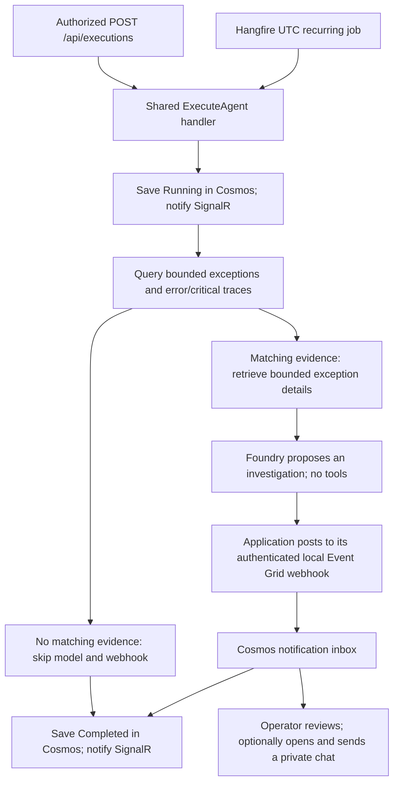

# Agent Observatory

[](LICENSE)

**Turn Application Insights errors into evidence-backed investigation proposals—with a human in control.**

Agent Observatory is a developer-focused Azure demo built with **.NET 10, Razor Pages, Vue 3 and Microsoft Agent Framework**. Inspect telemetry, run investigations on demand or on a UTC schedule, and follow durable execution history alongside private Microsoft Foundry conversations.

[Overview](#overview) · [Architecture](#architecture) · [Local development](#local-development) · [Testing](#testing) · [Deployment & operations](#deployment-operations) · [Documentation](#documentation) · [License](#license)

> [!IMPORTANT]
> Investigations are implemented, not just request logging: matching evidence can trigger a real, billable Foundry model call. **No remediation is executed automatically.** Results are proposals for human review; opening one only prefills a chat draft.

<a id="overview"></a>

## 🔭 Overview & capabilities

| Surface | What you can do |
|---|---|
| Overview | Read request counts, failures, mean latency and exception counts from your selected Application Insights resource. |
| Schedules | Inspect the UTC cron definition, next/last dispatch and separate scheduled execution history. |
| Execution API | Start authorized API-triggered investigations and read their durable lifecycle status and correlation IDs through the bearer-only API. |
| Application logs | Browse paged, bounded Application Insights traces, separate from execution storage. Missing configuration and query failures are explicit—not fabricated healthy data. |
| Agent chat | Use private Cosmos-backed sessions, recent conversation context, earlier-message paging, model-labelled replies and copying. Read-only tools can list exceptions/traces, retrieve exception details and correlate operation timelines. |
| Webhook inbox | Search, filter and page durable Event Grid notifications; expand full message/raw-event details. Operators can open a private chat draft or explicitly mark a notification handled, with an optional comment. |
| Diagnostic checks | Operators can emit test telemetry or send a test event through the real local webhook, without starting an investigation. |
| Identity and telemetry | Entra reader/operator web sessions, bearer-only execution API, and Application Insights web/log plus OpenTelemetry agent/model/tool/token instrumentation. |

The browser uses Vue components and the official SignalR client, bundled with Vite. Razor supplies application-local endpoint URLs; there is no separate frontend server.

<a id="architecture"></a>

## 🏗️ Architecture & execution flow

### Investigation workflow



Failures and cancellation are also recorded; live notifications are best-effort. Cosmos history—not SignalR or application logs—is authoritative.

### Execution API and scheduled investigations

To start an on-demand investigation, an external caller sends `POST /api/executions`; no request body is required. Read endpoint-triggered history through `GET /api/executions` or `GET /api/executions/{id}`. There is no Endpoint runs page; the API and scheduled investigations remain available.

| Entry point | Authorization | Execution |
|---|---|---|
| Execution API | Valid Entra bearer token for this API, with `AgentOps.Operator` role **or** the exact `Agent.Run` scope (configured defaults). A browser session cookie alone is insufficient. | Rate-limited; awaits the investigation in the HTTP request and returns its record on success. It does **not** enqueue a Hangfire job. Trigger: `Endpoint`. |
| UTC schedule | Application-hosted Hangfire job, configured through `Scheduling`. | One background worker calls the same handler. Trigger: `Schedule`, shown separately on Schedules. |

One scheduled worker does not serialize concurrent API requests. No Hangfire administrative dashboard is exposed.

Each new execution follows this path:

1. **Record the start.** Save `Running` in the Cosmos `/trigger` partition, with caller, UTC start time and correlation ID, then publish a live update.
2. **Collect evidence.** Query recent exceptions and severity 3/4 traces from `Insights:ResourceId`, within the configured lookback before the execution's original start. Retrieve exception details within the remaining query budget. Row, field, total-input, call-count and timeout limits apply; this automated path does not query operation timelines.
3. **Analyze only when needed.** Successful, untruncated empty queries finish without a model call or notification. Otherwise, sanitized, bounded evidence goes to the configured Foundry model with **no tools**. Empty model text or text without any supplied evidence reference fails the run; a reference check is not proof that the diagnosis is correct.
4. **Deliver a proposal.** Application code posts one `AgentOps.ErrorInvestigationProposed` event to this process's webhook using its server-side key. The webhook persists an unhandled inbox notification; the model cannot choose credentials, destinations or handled state.
5. **Record the outcome.** Save the terminal record using a separate bounded finalization token, then notify SignalR. Query/model/delivery exceptions propagate to HTTP error handling rather than becoming a successful result.

| Terminal status | Meaning |
|---|---|
| `Completed` | A proposal was delivered/already exists, or successful empty queries needed no analysis. **Not** “incident resolved.” |
| `Failed` | Investigation failed—for example, missing telemetry configuration, a query/model error or unacknowledged webhook delivery. Correlated logs contain details. |
| `Canceled` | The caller canceled or the execution timed out; finalization still attempts to persist the outcome. |

Select an inbox proposal to reserve a private chat and prefill its draft. **Sending the draft and marking the notification handled are separate, explicit operator actions.** Chat has read-only telemetry tools; neither path executes fixes.

> [!WARNING]
> Scheduling state and queues are **in-memory** and lost on restart; the recurring definition is re-registered, but missed work is not recovered. Failed agent jobs have no automatic retries, and proposal delivery has no automatic retry. Shutdown requeues reuse the execution ID/window and inbox IDs deduplicate redelivery, but this is **not exactly-once execution**. Different runs can inspect overlapping evidence; a lost delivery acknowledgement can leave a proposal alongside a failed/canceled run. An interrupted process or failed finalization can leave history at `Running`.

Trace the implementation: [API entry point](src/AgentOps.Web/Features/Executions/ExecutionEndpoints.cs), [shared lifecycle](src/AgentOps.Web/Features/Executions/ExecuteAgent.cs), [investigation runner](src/AgentOps.Web/Features/Agent/ErrorInvestigationRunner.cs), and [execution feed](src/AgentOps.Web/Frontend/components/ExecutionFeed.vue). See [architecture](docs/architecture.md) for recovery and concurrency boundaries.

### Repository layout

| Path | Purpose |
|---|---|
| `src\AgentOps.slnx` | .NET solution and SDK/build settings. |
| `src\AgentOps.Web\Features` | Agent, Chat, Executions, Identity, Insights, Notifications, Scheduling and Webhooks vertical slices. |
| `src\AgentOps.Web\Infrastructure` | Typed options, Azure clients, identity/hosting composition, telemetry and readiness. |
| `src\AgentOps.Web\Pages` / `Frontend` | Razor shells and Vue/SignalR source; Vite emits the browser bundle into `wwwroot`. |
| `src\tests` | Managed, HTTP/SignalR, scheduler and opt-in integration/browser tests. |
| `scripts` / `azure` / `containers` | Local tooling, Bicep/deployment automation and Linux image. |

---

<a id="local-development"></a>

## 💻 Local development

### Prerequisites

Stable .NET 10 SDK (selected by `src\global.json`), Node.js 24 LTS, PowerShell 7, Azure CLI, a native Windows Cosmos DB emulator or already running local emulator, and an Entra web/API registration. Run commands below from the repository root; the launcher builds managed code from `src`.

### Configure identity and services

1. Follow [Entra setup](docs/local-development.md#configure-microsoft-entra-id): register `https://localhost:5080/signin-oidc`, configure the confidential web client, define roles/API scope, and assign your user a role. Local browsing never bypasses authentication.
2. Store settings with [user-secrets](docs/local-development.md#store-local-settings), never tracked JSON. **Both the web-client credential and `Webhook:ApiKey` are required**; the guide shows secure input for these secrets. Configure the local emulator connection string and trust its certificate.

   ```powershell
   $project = '.\src\AgentOps.Web\AgentOps.Web.csproj'
   dotnet user-secrets set 'AzureAd:TenantId' '<tenant-guid>' --project $project
   dotnet user-secrets set 'AzureAd:ClientId' '<application-client-guid>' --project $project
   dotnet user-secrets set 'Cosmos:ConnectionString' '<local-emulator-connection-string>' --project $project
   dotnet user-secrets set 'Insights:ResourceId' '<full-application-insights-resource-id>' --project $project
   dotnet user-secrets set 'ApplicationInsights:ConnectionString' '<app-telemetry-connection-string>' --project $project
   dotnet user-secrets set 'Foundry:ProjectEndpoint' '<https-foundry-project-endpoint>' --project $project
   dotnet user-secrets set 'Foundry:ModelDeployment' '<deployed-model-name>' --project $project
   ```

3. Grant the Azure SDK identity **Monitoring Reader** on the monitored Insights resource and access to the Foundry project/model. Keep `InsightsTools:Enabled=true` with at least two calls for investigations. Background webhook delivery needs a concrete `AllowedHosts` entry (`localhost` by default) and a reachable local listener. Until telemetry/model access is ready, set `Scheduling:Enabled=false` to avoid failed scheduled investigations.

### Launch the application

Sign in, trust the development certificate, and launch:

```powershell
az login --tenant '<tenant-guid>'
dotnet dev-certs https --trust
.\scripts\run-web.ps1
```

The launcher starts the native emulator if necessary, builds frontend/C# assets, waits for persistence readiness and opens **https://localhost:5080**. Development creates missing execution, chat **and notification** containers. Ctrl+C stops only the tracked web process; the shared emulator stays running.

```powershell
.\scripts\run-web.ps1 -SkipEmulatorStart -NoBrowser
.\scripts\run-web.ps1 -WebPort 5085 -NoBrowser
```

Use your configured emulator connection string with `-SkipEmulatorStart`; register alternate HTTPS ports as Entra redirect URIs. There is no scheduling database or local database-container requirement.

> [!NOTE]
> `Insights:ResourceId` selects telemetry to **read**; `ApplicationInsights:ConnectionString` selects where this app **writes** telemetry. These may be different resources. Azure SDK access uses `DefaultAzureCredential` outside Production and `ManagedIdentityCredential` in Production. Non-Development Cosmos requires trusted HTTPS, token authentication and pre-provisioned containers.

<a id="testing"></a>

## 🧪 Testing

### Standard verification

```powershell
# Clean frontend install, frontend tests, Vite build and Release managed tests
.\scripts\test.ps1

# WSL alternative; build frontend assets first
.\scripts\test-wsl.ps1 -Distribution FedoraLinux-42
```

With frontend assets already built:

```powershell
Push-Location src
dotnet test AgentOps.slnx --configuration Release
Pop-Location
```

MSTest covers shared execution behavior, authorization, cancellation, real Hangfire/SignalR integration and investigation contracts with test adapters.

### Opt-in integrations

Real external integrations are opt-in:

| Check | Prerequisite |
|---|---|
| Cosmos emulator | `AGENTOPS_TEST_COSMOS_CONNECTION_STRING`; isolated local databases, including persistence beyond a scheduler host's lifetime. |
| Browser | Playwright Chromium/Edge and `AGENTOPS_BROWSER_TESTS=true`. |
| Live Azure telemetry/chat | `AGENTOPS_LIVE_AZURE_TESTS=true`, configured resource/model and Azure permissions; incurs usage. |

Tests without required opt-in prerequisites report inconclusive, not simulated integration success. See [testing](docs/testing.md) for selectors, browser setup, Bicep/Pester checks and package-proxy configuration.

<a id="deployment-operations"></a>

## 🚀 Deployment & operations

### Deploy to Azure

Follow the [Azure deployment guide](azure/README.md). `azure\scripts\Deploy-All.ps1` provisions resources, builds/pushes the Linux image with **ACR Tasks**, deploys its immutable digest, waits for readiness, then registers and validates the Event Grid subscription. No local Docker daemon is required. `-WhatIf` produces a local plan without Azure changes; local launch/test scripts do not deploy.

| Area | Deployment behavior |
|---|---|
| Runtime | Non-root multi-stage container on Azure Container Apps, one replica and one active revision. |
| Data and identity | User-assigned managed identity, Cosmos execution/chat/notification containers, Key Vault and scoped access. New Cosmos accounts disable key authentication; reused accounts retain their existing settings. |
| Observability and events | Workspace-based Application Insights and Event Grid topic/subscription with an authenticated webhook. |
| Foundry | Account/project and configurable model deployment; Bicep defaults to **GPT-5.5**. Chat and evidence-backed investigations invoke the configured deployment and can incur charges. |
| Resource reuse | Omit `-AcrName` to create ACR, or supply an existing registry. Use `-CosmosAccountName` / `-CosmosResourceGroup` to reuse Cosmos; private connectivity preserves the shared account's network settings. |

`azure\scripts\Initialize-EntraApplication.ps1` can create a dedicated web/API registration and configure callbacks; human role assignment and consent remain separate.

### Production boundaries and health probes

> [!CAUTION]
> This is a demo, not a production hardening baseline. Keep one replica: scheduling, SignalR and cookie keys lack distributed backing. Design network isolation, persistent encrypted cookie keys, retention, recovery and action authorization/idempotency before production use or enabling remediation.

Anonymous probes: `/health` and `/health/ready` check all three Cosmos containers; `/health/live` checks process liveness. They do not prove Insights or Foundry connectivity. Pages, execution API and SignalR remain protected; the Event Grid webhook uses its own API-key authentication.

---

<a id="documentation"></a>

## 📚 Documentation

| Goal | Guide |
|---|---|
| Start locally and authenticate | [Local development](docs/local-development.md) |
| Configure identity, telemetry, models and limits | [Configuration reference](docs/configuration.md) |
| Call the execution API and consume live events | [API reference](docs/api.md) |
| Understand lifecycle, evidence and persistence boundaries | [Architecture](docs/architecture.md) |
| Verify managed, browser, emulator and Azure behavior | [Testing](docs/testing.md) |
| Provision and deploy | [Azure deployment](azure/README.md) |
| Find script/image details | [Scripts](scripts/README.md) · [Containers](containers/README.md) |
| Browse all guides | [Documentation index](docs/README.md) |

<a id="license"></a>

## ⚖️ License

Licensed under the [MIT License](LICENSE). Copyright © 2026 Bojan Vrhovnik.
