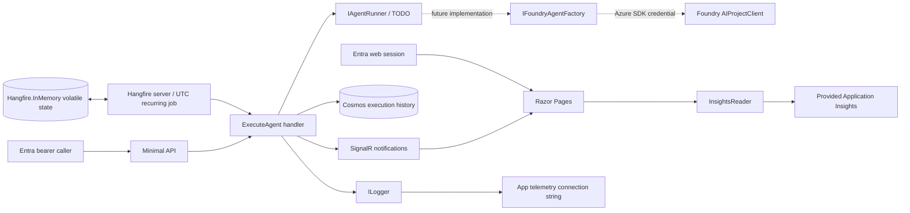

# Architecture

Agent Observatory is a small vertical-slice application. The objective is to keep orchestration real while deferring the business behavior of the agent.

## Feature boundaries

`Features/Agent` contains the Microsoft Agent Framework factory and the explicit placeholder runner. The factory creates an `AIAgent` through `AIProjectClient.AsAIAgent`; it is not called by the placeholder runner.

`Features/Executions` owns the shared execution handler, immutable records, Cosmos adapter, Minimal API and notification hub. HTTP and scheduled execution use the same handler, so persistence, correlation, error behavior and live events remain consistent.

`Features/Scheduling` owns typed scheduling options, Hangfire ASP.NET Core registration, startup registration and the DI-activated `AgentJob`. The official Hangfire.InMemory provider stores queued work and scheduling state in this process, not Cosmos or a relational database. The authenticated Schedules page displays the registered next/last dispatch from Hangfire and authoritative execution history from Cosmos.

`Features/Insights` reads bounded aggregates and traces. Query errors appear explicitly in the UI, rather than being converted into misleading zeros. Empty metrics and missing configuration are different states.

`Features/Identity` configures Entra web/API authentication and role/scope policies. Razor Page models are thin adapters around feature services. `Infrastructure` hosts validated options, Azure client composition and readiness checks.

## Three separate data planes

1. **Execution history:** Cosmos DB, partitioned by `/trigger` (`Endpoint` or `Schedule`). Records describe when work was requested, who requested it, its lifecycle and its correlation ID.
2. **Job scheduling:** volatile Hangfire.InMemory storage with a stable recurring job ID. A dispatch can yield an execution with `NotImplemented`; Hangfire job success means the scaffold finished, not that an AI action occurred.
3. **Application diagnostics:** structured logs, requests, dependencies and exceptions sent to Application Insights through its connection string. Logs are not reconstructed into execution history.

The browser receives only committed execution records. Full execution history is never inferred from transient SignalR delivery. Both the initial query and live table are bounded by `Executions:HistoryLimit`. The two-value partition scheme is for low-volume demonstration history; production retention/bucketing must address Cosmos logical-partition limits.

## Environment boundary

Development connects to the local Cosmos emulator using a connection string. The direct web launcher prefers the native Windows emulator; no container orchestration is required. The app provisions the Development database and execution-history container. Hangfire needs no external storage.

Outside Development, Cosmos requires a trusted HTTPS endpoint and token authentication; insecure emulator TLS, connection strings and app-driven Cosmos provisioning are rejected. Azure SDK clients share `DefaultAzureCredential` outside Production and `ManagedIdentityCredential` in Production, selecting the user-assigned identity from `AZURE_CLIENT_ID` when configured. Bicep provisions the Cosmos resources and grants the app identity data-plane access to the database.

An existing Cosmos account is referenced, never redeclared for an update. Only the dedicated database/container and scoped role are deployed in its resource group. Private-account reuse creates a VNet-integrated Container Apps environment, private endpoint and private DNS in the app resource group, preserving the shared account's disabled public access.

The OIDC web client credential is unrelated to Cosmos/model API keys and stays in Key Vault.

## In-memory scheduling contract

Startup validates the five-field UTC cron expression and registers exactly one recurring `AgentJob` using Hangfire's `IRecurringJobManager.AddOrUpdate`. Disabled scheduling removes that definition; the server can still process explicitly enqueued background work. Registration/configuration failures propagate and fail host startup. The real Hangfire server uses one worker and its standard minute-granularity recurring scheduler. The job receives DI services and Hangfire's cooperative cancellation token, then calls the same `ExecuteAgent` as the synchronous API.

**All Hangfire queues, dispatch metadata and state are lost when the process exits.** Each startup re-registers the recurring definition from configuration; it does not recover missed occurrences or queued work. Cosmos execution records survive, and an interrupted run may remain `Running`. Inspect history and correlation before manual recovery. No custom Cosmos scheduler or schedule container is used.

`AgentJob` sets `AutomaticRetry(Attempts = 0)` so agent failures are not automatically retried. This is **not** an exactly-once or at-most-once action guarantee: Hangfire can requeue interrupted work during cooperative shutdown while the process/storage remains alive. Agent/tool cancellation must remain cooperative, and actions must gain an explicit idempotency/recovery contract before implementation. Recurring occurrences can queue behind a long-running job; one worker serializes scheduled execution but does not block concurrent synchronous API requests. Keep the single-replica/single-active-revision policy: separate processes have independent schedules and would double dispatch. No administrative Hangfire dashboard is mapped.

## Intentional limitations and next implementation

The two TODO comments in `PendingAgentRunner` are the implementation boundary for instructions, tools, input selection, safety policy and run/session lifecycle. Azure infrastructure now deploys GPT-5.5 by default (configurable or disabled with `deployFoundryModel=false`); that provisioned deployment is not called by the placeholder runner.

`azure/scripts/Deploy-All.ps1` separates resource provisioning from image build and activation. Bicep creates or reuses ACR, configures identity/telemetry/Cosmos/Foundry, and initially omits the app. ACR Tasks builds and pushes the image; the script verifies its digest, then redeploys Bicep with the app enabled and that immutable digest. Existing ACRs can be in another resource group/subscription and receive a managed-identity pull grant without changing their settings.

Forwarded headers run before redirects, authentication and SignalR origin validation. Known proxies/networks can be configured explicitly. The deployment enables the Container Apps ingress trust mode for one hop; only do so where network access to Kestrel is constrained to that ingress.

`RouteConstants.cs` centralizes application routes and virtual assets. Server-rendered data attributes supply browser endpoint URLs. Anonymous `/health`, `/health/live` and `/health/ready` remain reachable by internal HTTP probes without a success-shaped HTTPS redirect; only the exact health routes bypass that redirect.

Before enabling real actions, define input contracts, supported outcomes, idempotency, concurrency/overlap policy, authorization of tools, human approval for impactful actions, bounded retries, cancellation, evaluation and output redaction.

This demo does not implement persistent encrypted Data Protection keys, distributed SignalR, execution pagination/retention, transactional notifications, recovery of abandoned runs, durable scheduling, or production network isolation. Container Apps is fixed to one replica and one active revision; process restarts may invalidate browser sessions. Schedule changes and image upgrades still need an operational rollout policy.

The Bicep defaults are demonstration sizing, not an availability/SLO commitment. Replace public Foundry access with private networking before sensitive production use. New Cosmos accounts are public unless private connectivity is selected; reused accounts default to private connectivity.
